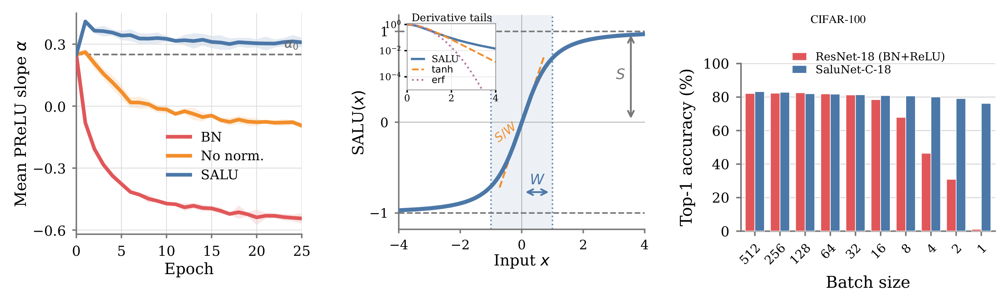

# Geometry, Not Statistics: SaluNet for Normalization-Free CNNs and Transformers

*Normalization moves the distribution. Derf moves the function. SALU deforms the function around a fixed center.*

**Reference implementations, experiment configurations, and pretrained checkpoints accompanying the paper.**

SaluNet explores replacing feature normalization layers with the **Saturated Adaptive Linear Unit (SALU)**, a learnable elementwise transformation that does not compute batch or token feature statistics. Its gated variants, **SWALU** and **GALU**, provide learnable activation functions.

This repository contains PyTorch and PyTorch Lightning implementations, training and evaluation scripts, and experiment configurations for CIFAR-10 and CIFAR-100. PyTorch reference scripts are also provided for SaluNet-C-50 and SaluNet-T-B/16 on ImageNet-1K; conversion to PyTorch Lightning and integration into the unified codebase are ongoing. The results section also summarizes the ImageNet experiments reported in the manuscript.

📣 **Research announcement and discussion:** [Read the thread on X](https://x.com/Mourad_ZAIED/status/2119487366918480035)



**From normalization-dependent activation plasticity to geometric stabilization.**
**Left (CIFAR-10):** Mean PReLU slope across three activation layers under BN,
no normalization, and SALU. Curves and bands report the mean and one standard
deviation over three seeds; the dashed line marks $\alpha_0=0.25$.
**Center:** SALU fixes the geometric center at the origin while learning the
saturation amplitude $S$, transition width $W$, and local gain $S/W$.
The inset contrasts its polynomial derivative decay with those of $\tanh$
and $\mathrm{erf}$.
**Right (CIFAR-100):** SaluNet-C-18 remains trainable as batch size decreases
from 512 to 1, whereas the matched ResNet-18 (BN+ReLU) baseline degrades sharply
at small batch sizes.

[View the vector figure (PDF)](assets/teaser.pdf).

## Operators

For positive coefficients $a$ and $b$, SALU is defined as

$$
\phi(x;a,b)=\frac{ax}{\sqrt{1+abx^2}}.
$$

Its slope at the origin is $a$, its asymptotic magnitude is $\sqrt{a/b}$, and its characteristic transition scale is $(ab)^{-1/2}$. The coefficients are learned during training; their positivity policy and initialization depend on the experiment configuration.

The corresponding gated activations are

$$
\mathrm{SWALU}(x;a,b)=\frac{x}{2}\left(1+\phi(x;a,b)\right),
$$

$$
\mathrm{GALU}(x;a,b)=\frac{x}{2}\left(1+\phi(\psi(x);a,b)\right),
\qquad
\psi(x)=\sqrt{\frac{2}{\pi}}\left(x+0.044715x^3\right).
$$

SALU is bounded for fixed positive coefficients. SWALU and GALU, as defined above, are unbounded. Output clipping, when enabled in a particular experiment, is an additional implementation choice and is not part of these definitions.

## Model families

- **SaluNet-C:** convolutional models with SALU in place of normalization layers, optionally combined with SWALU or GALU activations.
- **SaluNet-T:** Vision Transformer experiments with configurable normalization and activation choices, including SALU and gated variants.

For the ResNet experiments, gate parameters are shared across activation calls within a residual block. The stem has its own activation module.

## Results

All accuracies are percentages. **Main** denotes the directly optimized model;
**EMA** denotes the exponential moving average model. CIFAR EMA and Main columns
report mean ± sample standard deviation of per-run best accuracies across
different random seeds. Exact run counts and seed lists are not specified here.

### ResNet-18 / CIFAR

| Dataset | Stabilizer + activation | Runs | EMA Top-1 (%) | Main Top-1 (%) | Best Top-1 (%) |
|---|---|---:|---:|---:|---:|
| CIFAR-10 | BN + ReLU | Multiple | 96.95 ± 0.09 | 96.93 ± 0.08 | 97.02 |
| CIFAR-10 | SALU + SWALU | Multiple | 97.08 ± 0.05 | 97.05 ± 0.06 | 97.24 |
| CIFAR-10 | SALU + GALU | Multiple | **97.19 ± 0.11** | **97.17 ± 0.10** | **97.35** |
| CIFAR-100 | BN + ReLU | Multiple | 80.68 ± 0.64 | 80.89 ± 0.25 | 81.26 |
| CIFAR-100 | BN + SWALU | Multiple | 81.13 ± 0.24 | 81.14 ± 0.21 | 81.33 |
| CIFAR-100 | SALU + ReLU | Multiple | 80.37 ± 0.07 | 79.97 ± 0.19 | 80.45 |
| CIFAR-100 | GN + ReLU | Multiple | 80.75 ± 0.28 | 79.95 ± 0.27 | 80.97 |
| CIFAR-100 | GN + SWALU | Multiple | 82.53 ± 0.34 | 81.69 ± 0.28 | 82.78 |
| CIFAR-100 | SALU + GALU | Multiple | 82.95 ± 0.31 | **82.37 ± 0.34** | 83.25 |
| CIFAR-100 | SALU + SWALU | Multiple | **83.02 ± 0.29** | 82.36 ± 0.31 | **83.27** |

ResNet-18 experiments use 300 epochs. **Best** denotes a separately reported
best observed result and need not belong to the runs summarized in the means.
The additional deterministic CIFAR-100 run is distinguished below.

#### SALU + SWALU / CIFAR-100: execution settings

| Configuration | Execution mode | Runs | EMA Top-1 (%) |
|---|---|---:|---:|
| SALU + SWALU | Non-deterministic | Multiple | 83.02 ± 0.29 |
| SALU + SWALU | Deterministic | 1 | **83.42** |

- **Non-deterministic cohort:** `deterministic: false`, `cudnn_benchmark: true`.
- **Deterministic run:** `deterministic: true`, `cudnn_benchmark: false`.

The deterministic run is reported separately because its execution settings
differ from those of the non-deterministic cohort. It is excluded from that cohort's
mean and sample standard deviation. The best EMA accuracy within the cohort is
83.27%. A single run does not establish an accuracy advantage of deterministic
execution.

Training logs:

- [Deterministic run — 83.42% EMA Top-1](https://forge.coreweave.com/wandb/SaluNet/salunet-c-18-c100/runs/wyneddgb)
- [Non-deterministic run with SALU/SWALU parameter tracking](https://forge.coreweave.com/wandb/SaluNet/salunet-c-18-c100/runs/7iwezan9)

For the CNN CIFAR-100 comparison, BN models use EMA decay 0.997; SALU, GN, and
RMSNorm use 0.9997. Main-model results provide a comparison independent of
this EMA smoothing choice.

### Compact ViT / CIFAR

| Dataset | Stabilizer + activation | Runs | EMA Top-1 (%) | Main Top-1 (%) | Best Top-1 (%) |
|---|---|---:|---:|---:|---:|
| CIFAR-10 | LN + GELU | Multiple | 91.43 ± 0.31 | 91.29 ± 0.29 | 91.61 |
| CIFAR-10 | SALU + GELU | Multiple | 91.39 ± 0.21 | 91.22 ± 0.11 | 91.63 |
| CIFAR-10 | SALU + GALU | Multiple | 91.70 ± 0.17 | 91.47 ± 0.15 | 91.89 |
| CIFAR-10 | SALU + SWALU | Multiple | **91.91 ± 0.19** | **91.92 ± 0.16** | **92.11** |
| CIFAR-100 | DyT + GELU | Multiple | 65.32 ± 0.49 | 64.15 ± 0.70 | 65.85 |
| CIFAR-100 | RMSNorm + GELU | Multiple | 67.86 ± 0.36 | 66.76 ± 0.34 | 68.20 |
| CIFAR-100 | LN + GELU | Multiple | 68.66 ± 0.13 | 67.26 ± 0.25 | 68.76 |
| CIFAR-100 | SALU + GALU | Multiple | 70.29 ± 0.11 | **69.64 ± 0.29** | 70.37 |
| CIFAR-100 | SALU + SWALU | Multiple | 70.11 ± 0.48 | 69.22 ± 0.43 | 70.56 |
| CIFAR-100 | SALU + GELU | Multiple | **70.39 ± 0.41** | 69.56 ± 0.51 | **70.82** |

All compact ViT configurations, including baselines, are rerun in the same
implementation for **200 epochs**. **Best** is the maximum across the summarized
runs and both model variants. The ordinary learning rate is 0.0005 on CIFAR-10
and 0.001 on CIFAR-100. DyT uses an empirically selected initial alpha of 1.

The highest observed EMA mean uses SALU + SWALU on CIFAR-10 and SALU + GELU on
CIFAR-100. Gate benefits are therefore dataset-dependent; these experiments do
not isolate the effect of learning the gate parameters.

**Checkpoint selection:** CIFAR experiments evaluate the official test set after
each epoch and select Main and EMA maxima independently. Repeated test-set
selection can introduce optimism; these results are not held-out estimates after
validation-only checkpoint selection.

### ImageNet-1K

| Model | Training epochs | Physical / effective batch | Evaluation crop | EMA Top-1 (%) | EMA Top-5 (%) |
|---|---:|---:|---:|---:|---:|
| SaluNet-C-50 | 150, with 4N training views per epoch | 180 / 900 | 224 × 224 | 79.59 | 94.59 |
| SaluNet-C-50 | Same checkpoint | 180 / 900 | 288 × 288 | 80.16 | 94.96 |
| SaluNet-T-B/16 | 300 | 128 / 128 | 224 × 224 | 80.12 | 94.79 |
| SaluNet-T-B/16 | Same checkpoint | 128 / 128 | 288 × 288 | 80.28 | 94.74 |

- Each backbone is represented by **one completed run**, trained from scratch on
  one shared NVIDIA A40 GPU with 24 GB available to the training process. No
  run-to-run standard deviation is reported.
- SaluNet-C-50 uses five-step gradient accumulation. Its sampler shuffles all
  four copies of each training index without truncation: 150 scheduled epochs
  therefore correspond to **600N training views**, where N is the training-set
  size. This is not the same epoch budget as TorchVision's truncated RA sampler.
- SaluNet-T-B/16 uses no gradient accumulation. Its adapted effective batch and
  learning rate differ from the published Derf recipe; the result is a
  scalability experiment rather than a recipe-matched operator comparison.
- The 288 × 288 evaluations reuse the selected EMA checkpoints **without further
  training or fine-tuning**. The ViT positional embedding is interpolated for
  the higher evaluation resolution.
- **Training preprocessing (both models):** images are resized offline
  so that the longest side is 320 pixels, preserving aspect ratio with
  Lanczos interpolation, and saved as JPEG at quality 95.
  Online training augmentations and random crops are then applied.
- **SaluNet-C-50 evaluation:** uses the original 50,000 ImageNet-1K
  validation images, with online bilinear resizing and center cropping:
  resize 240 / crop 224, or resize 320 / crop 288.
- **SaluNet-C-50 reference implementation:** SWALU outputs are clamped
  to [-10, 10] during both training and evaluation.
- **SaluNet-T-B/16 evaluation:** uses the 50,000 validation images
  preprocessed offline in the same way as the training images,
  followed by online bicubic resizing and center cropping.
  
### Physical batch-size robustness

| Physical batch size | ResNet-18, BN + ReLU, CIFAR-100 | SaluNet-C-18, SALU + SWALU, CIFAR-100 | SaluNet-C-18, SALU + GALU, CIFAR-10 |
|---:|---:|---:|---:|
| 512 | 82.15 | 83.25 | 97.35 |
| 256 | 82.32 | 82.86 | 97.25 |
| 128 | 82.55 | 82.00 | 97.30 |
| 64 | 81.90 | 81.74 | 97.20 |
| 32 | 81.27 | 81.38 | 97.35 |
| 16 | 78.49 | 80.91 | 97.10 |
| 8 | 67.90 | 80.69 | 97.08 |
| 4 | 46.47 | 80.07 | 96.60 |
| 2 | 30.90 | 79.12 | 95.57 |
| 1 | 1.10 | 76.23 | 93.44 |

The table reports measured test accuracies from the batch-size experiments,
rather than averages across multiple seeds. Batch sizes of at least 8 were explored with multiple seeds; settings
below 8 use one completed run per configuration. The learning-rate policy is
adapted identically for the compared models within each dataset and batch size.
These sweep records should not be substituted for the primary aggregate results.

<details>
<summary>Additional historical ResNet-18 / CIFAR-100 comparisons</summary>

| Configuration | EMA Top-1 (%) | Main Top-1 (%) | Best EMA Top-1 (%) |
|---|---:|---:|---:|
| RMSNorm + ReLU | 80.54 ± 0.31 | 79.71 ± 0.22 | 80.87 |
| RMSNorm + SWALU | 82.39 ± 0.30 | 81.62 ± 0.23 | 82.69 |
| DyT + ReLU | 79.93 ± 0.16 | 79.12 ± 0.03 | 80.08 |
| DyT + SWALU | 81.42 ± 0.15 | 79.30 ± 0.06 | 81.58 |

These comparisons are retained from the original experiment set. Means and
sample standard deviations summarize runs with different seeds; Best is the retained
best EMA record. They are reported separately from the updated SaluNet
aggregate results.

</details>

## Installation

Clone the repository:

```bash
git clone https://github.com/MouradZaied/SaluNet.git
cd SaluNet
```

Create and activate a Python environment (Python 3.10 was tested).

### Tested CUDA 12.1 installation

The following installation was tested on an NVIDIA A40-24Q with driver
525.85.05 using Python 3.10. Training and validation were successfully
executed with PyTorch 2.4.0 and torchvision 0.19.0.

Update the installation tools:

```bash
python -m pip install --upgrade pip setuptools wheel
```

Install the tested PyTorch/torchvision pair:

```bash
python -m pip install --no-cache-dir \
  --index-url https://download.pytorch.org/whl/cu121 \
  torch==2.4.0 torchvision==0.19.0
```

Install SaluNet and its remaining dependencies while preserving these versions:

```bash
python -m pip install --no-cache-dir \
  -e . "torch==2.4.0+cu121" "torchvision==0.19.0+cu121"
```

Check dependency consistency:

```bash
python -m pip check
```

Verify GPU access and a CUDA computation:

```bash
python - <<'PY'
import torch
import torchvision

print("PyTorch:", torch.__version__)
print("torchvision:", torchvision.__version__)
print("CUDA available:", torch.cuda.is_available())

x = torch.randn(256, 256, device="cuda")
y = x @ x
torch.cuda.synchronize()

print("GPU:", torch.cuda.get_device_name(0))
print("CUDA computation: OK")
PY
```

### Other hardware and CUDA versions

Install a compatible PyTorch/torchvision pair following the instructions at
[pytorch.org](https://pytorch.org/get-started/locally/), then install SaluNet:

```bash
python -m pip install -e .
```

The dependency ranges in `requirements.txt` and `pyproject.toml` allow
multiple PyTorch versions. The appropriate CUDA build depends on your
NVIDIA driver; installing the newest available build may require a newer
driver.

GPU memory usage depends on the architecture, batch size, numerical
precision, and compilation settings. Ensure sufficient free disk space
for PyTorch and its CUDA dependencies.

## Training

Run commands from the repository root. Review dataset locations, batch size, logging settings, seed, and output paths in the selected YAML file before launching.

### SaluNet-C / CIFAR-10

```bash
python scripts/train.py --config configs/experiments/salunet-c-18/cifar10/salunet-c-18_cifar10.yaml
```

### SaluNet-C / CIFAR-100

Reference configuration with deterministic execution (seed 142):

```bash
python scripts/train.py --config configs/experiments/salunet-c-18/cifar100/salunet-c-18_cifar100_deterministic.yaml
```

Non-deterministic configuration with SALU/SWALU parameter logging:

```bash
python scripts/train.py --config configs/experiments/salunet-c-18/cifar100/salunet-c-18_cifar100_salu_swalu_a_b.yaml
```

The second configuration provides non-deterministic SALU + SWALU
training at seed 42 with parameter tracking enabled. It is a corrected
tracking configuration, not an exact reconstruction of the historical
linked run, and is not intended to reproduce the 83.42% result.

Additional configurations are available under `configs/experiments/`, including CIFAR-10 experiments and alternative normalization/activation combinations. Use the configuration associated with the experiment you intend to reproduce; different configurations may use different recipes.

### SaluNet-T / CIFAR-10

```bash
python scripts/train.py --config configs/experiments/salunet-t/cifar10/salunet-t_cifar10_salu_swalu.yaml
```

### SaluNet-T / CIFAR-100

```bash
python scripts/train.py --config configs/experiments/salunet-t/cifar100/salunet-t_cifar100_salu_gelu.yaml
```

### Unified CIFAR command-line options

To inspect the unified CIFAR command-line options, run from the SaluNet repository root:

```bash
python scripts/train.py --help
python scripts/eval.py --help
```

### ImageNet training data preparation

Training images were resized offline with the following command:

```bash
python scripts/resize_imagenet_train.py \
  --input /path/to/original/train \
  --output /path/to/resized320/train \
  --size 320 \
  --workers 8 \
  --quality 95
```

This preserves class directories and aspect ratio, resizes the longest
side to 320 pixels using Lanczos interpolation, and saves JPEG images
at quality 95 using Pillow's default chroma subsampling.
Jupyter checkpoint copies are excluded.

Use this preprocessing for the training images of both models and
for the SaluNet-T-B/16 validation images.
SaluNet-C-50 evaluation uses the original validation images.
Online augmentations and evaluation transforms are applied afterward.


### SaluNet-C-50 / ImageNet-1K training

The [reference PyTorch script](imagenet/salunet-c-50/train_salunet_c50_reference.py)
uses clamped SWALU and contains its training configuration directly in the file.
Before launching, edit the two `ImageFolder` paths (default:
`/root/imagenet/train` and `/root/imagenet/val`) to point to your datasets,
and review the W&B project, checkpoint output paths, batch size, and worker count.
The reference recipe uses 150 epochs, physical batch size 180, and five-step
gradient accumulation (effective batch size 900 on one GPU).

Run from the repository root:

```bash
python imagenet/salunet-c-50/train_salunet_c50_reference.py
```

This standalone script does not accept the CIFAR `--config` option.
Its validation transform uses resize 256 / crop 224 during training;
the released checkpoint is evaluated below with resize 240 / crop 224
and resize 320 / crop 288.


### Experimental SaluNet-C-50 variant

An [experimental implementation](imagenet/salunet-c-50-experimental/README.md)
removes the SWALU output clamp and uses `abs + eps` for its positive parameters.
It also fixes the final gradient accumulation window, EMA updates, mixed-label
training accuracy, and checkpoint replacement.

This variant has not yet been validated on ImageNet. The reported SaluNet-C-50 results correspond to the reference implementation
with clamped SWALU.

Independent evaluations and shared training logs are welcome.


### SaluNet-T-B/16 / ImageNet-1K training

This implementation builds on the [Derf ViT codebase](https://github.com/zlab-princeton/Derf/tree/8dd9ea3cc70370f423a80a80af6f72466bc621db/ViT).
Replace its `ViT/main.py` with our supplied version, and add `salu.py`
and `test.py` to the same directory. The remaining upstream files are required. Follow the complete
[setup instructions](imagenet/salunet-t-b16/README.md) before running this command.

Our reference experiment uses a single GPU, a batch size of 128,
and no gradient accumulation. Run from the Derf `ViT` directory:

```bash
python main.py \
  --model vit_base_patch16_224 \
  --batch_size 128 \
  --lr 0.000125 \
  --model_ema true \
  --model_ema_eval true \
  --model_ema_decay 0.999 \
  --data_path /path/to/imagenet \
  --output_dir outputdir2/ \
  --normtype salu
```

With `--normtype salu`, LayerNorm is replaced by SALU and GELU by SWALU.
The reference run uses 300 epochs. The upstream large-batch recipe is
documented separately in the Derf repository.

### Resume training

Resume from a full Lightning checkpoint using the same training configuration:

```bash
python scripts/train.py \
  --config configs/experiments/salunet-c-18/cifar100/salunet-c-18_cifar100.yaml \
  --resume /path/to/last.ckpt
```

The checkpoint restores model and EMA weights, optimizer, scheduler, mixed-precision
state, training progress, and saved best scores. `epochs` specifies the total
training budget, not the number of additional epochs.

Use `last.ckpt` for resuming; the best-model `.pth` files are intended for evaluation.
Resuming does not guarantee an identical trajectory to uninterrupted training.


## Pretrained checkpoints

### Evaluate CIFAR checkpoints in Google Colab

Run the notebook to download and evaluate any of the four released CIFAR
checkpoints, with FP32 Top-1/Top-5 metrics. No local installation is required.
Enable a GPU runtime before running the cells.

[](https://colab.research.google.com/github/MouradZaied/SaluNet/blob/main/eval_notebook/SaluNet_CIFAR_Colab_EN.ipynb)

| Model | Dataset | Weights | Top-1 | Top-5 | Download |
| --- | --- | --- | --- | --- | --- |
| SaluNet-C-18 (SALU + GALU) | CIFAR-10 | EMA | 97.27% | 99.89% | [Checkpoint](https://huggingface.co/Mourad-zaied/SaluNet/resolve/main/best_ema_model_SaluNet-C-18_C10_97.27.pth?download=true) ([Google Drive mirror](https://drive.google.com/file/d/1IeYOrmdkGwm-cAaz2XKzfz4XhQ1dcSsp/view?usp=sharing)) |
| SaluNet-C-18 (SALU + SWALU) | CIFAR-100 | EMA | 83.42% | 96.25% | [Checkpoint](https://huggingface.co/Mourad-zaied/SaluNet/resolve/main/best_ema_model_SaluNet-C-18_C100_83.42.pth?download=true) ([Google Drive mirror](https://drive.google.com/file/d/11_BCqoLbV6SWW0Rdkjf68vjm06JVC8rj/view?usp=drive_link)) |
| SaluNet-T (SALU + GELU) | CIFAR-100 | EMA | 70.33% | 90.09% | [Checkpoint](https://huggingface.co/Mourad-zaied/SaluNet/resolve/main/best_ema_model_SaluNet-T_C100_SALU_GELU_70.33.pth?download=true) ([Google Drive mirror](https://drive.google.com/file/d/1u7D0Y3XUAgutq_LAiz8YzOH3XbNsVxkN/view?usp=sharing)) |
| SaluNet-T (SALU + GALU) | CIFAR-100 | EMA | 70.36% | 89.08% | [Checkpoint](https://huggingface.co/Mourad-zaied/SaluNet/resolve/main/best_ema_model_SaluNet-T_C100_SALU_GALU_70.36.pth?download=true) ([Google Drive mirror](https://drive.google.com/file/d/16YGnUTxVMLDhoKwgiuC_2DKMA-WvEJuQ/view?usp=sharing)) |

The four CIFAR checkpoints above were verified in FP32 on their respective
10,000-image test sets. Released checkpoints are distinguished from best
observed results: the CIFAR-10 C-18 checkpoint at 97.35% is no longer available,
and the T / SALU + GELU checkpoint at 70.33% is a separate run from the
70.82% best observed result. For C-18 / CIFAR-100, FP16 evaluation gives
83.43% Top-1 and 96.25% Top-5.

The four CIFAR checkpoints listed above and the two ImageNet checkpoints
described below were downloaded from Hugging Face and evaluated using
a fresh clone of this repository, with the documented Derf integration
for ViT-B/16. All four CIFAR checkpoints reproduced their listed
Top-1/Top-5 accuracies in FP32. At 288 × 288, the ImageNet checkpoints
reproduced 80.158% / 94.964% for SaluNet-C-50 and 80.276% / 94.740%
for SaluNet-T-B/16, using their respective documented evaluation protocols.

### SaluNet-C-18 / CIFAR-10 evaluation

Download the [EMA checkpoint](https://huggingface.co/Mourad-zaied/SaluNet/resolve/main/best_ema_model_SaluNet-C-18_C10_97.27.pth?download=true) ([Google Drive mirror](https://drive.google.com/file/d/1IeYOrmdkGwm-cAaz2XKzfz4XhQ1dcSsp/view?usp=sharing)) into the repository root as
`best_ema_model_SaluNet-C-18_C10_97.27.pth`, then run:

```bash
python scripts/eval.py \
  --config configs/experiments/salunet-c-18/cifar10/salunet-c-18_cifar10.yaml \
  --checkpoint best_ema_model_SaluNet-C-18_C10_97.27.pth \
  --normalization salu \
  --activation galu \
  --weights selected \
  --batch-size 512 \
  --num-workers 2 \
  --device cuda \
  --precision fp32
```

### SaluNet-C-18 / CIFAR-100 evaluation

Download the [EMA checkpoint](https://huggingface.co/Mourad-zaied/SaluNet/resolve/main/best_ema_model_SaluNet-C-18_C100_83.42.pth?download=true) ([Google Drive mirror](https://drive.google.com/file/d/11_BCqoLbV6SWW0Rdkjf68vjm06JVC8rj/view?usp=drive_link)) and save it as
`checkpoints/cifar100_salu_swalu/best_ema_model.pth`, then run:

```bash
python scripts/eval.py \
  --config configs/experiments/salunet-c-18/cifar100/salunet-c-18_cifar100_deterministic.yaml \
  --checkpoint checkpoints/cifar100_salu_swalu/best_ema_model.pth \
  --normalization salu \
  --activation swalu \
  --weights selected \
  --batch-size 512 \
  --num-workers 2 \
  --device cuda \
  --precision fp32
```

### SaluNet-T / CIFAR-100 — SALU + GELU evaluation

Download the [EMA checkpoint](https://huggingface.co/Mourad-zaied/SaluNet/resolve/main/best_ema_model_SaluNet-T_C100_SALU_GELU_70.33.pth?download=true) ([Google Drive mirror](https://drive.google.com/file/d/1u7D0Y3XUAgutq_LAiz8YzOH3XbNsVxkN/view?usp=sharing))
and save it in the repository root as
`best_ema_model_SaluNet-T_C100_SALU_GELU_70.33.pth`, then run:

```bash
python scripts/eval.py \
  --config configs/experiments/salunet-t/cifar100/salunet-t_cifar100_salu_gelu.yaml \
  --checkpoint best_ema_model_SaluNet-T_C100_SALU_GELU_70.33.pth \
  --normalization salu \
  --activation gelu \
  --weights selected \
  --batch-size 512 \
  --num-workers 2 \
  --device cuda \
  --precision fp32
```

### SaluNet-T / CIFAR-100 — SALU + GALU evaluation

Download the [EMA checkpoint](https://huggingface.co/Mourad-zaied/SaluNet/resolve/main/best_ema_model_SaluNet-T_C100_SALU_GALU_70.36.pth?download=true) ([Google Drive mirror](https://drive.google.com/file/d/16YGnUTxVMLDhoKwgiuC_2DKMA-WvEJuQ/view?usp=sharing))
into the repository root as
`best_ema_model_SaluNet-T_C100_SALU_GALU_70.36.pth`, then run:

```bash
python scripts/eval.py \
  --config configs/experiments/salunet-t/cifar100/salunet-t_cifar100_salu_galu.yaml \
  --checkpoint best_ema_model_SaluNet-T_C100_SALU_GALU_70.36.pth \
  --normalization salu \
  --activation galu \
  --weights selected \
  --batch-size 512 \
  --num-workers 2 \
  --device cuda \
  --precision fp32
```

### SaluNet-C-50 / ImageNet-1K evaluation

The model contains 53 SALU modules and 17 independent clamped-SWALU
modules. EMA weights were selected at epoch 118. No fine-tuning was
performed after checkpoint selection.

Download the [EMA checkpoint](https://huggingface.co/Mourad-zaied/SaluNet/resolve/main/salunet-c50-imagenet1k-clamped-swalu-ema-epoch118.pth?download=true) ([Google Drive mirror](https://drive.google.com/file/d/11-xtu1FyW6g-T53kRnTY3t2TjEvnGeVJ/view?usp=drive_link))
and save it in the repository root as
`salunet-c50-imagenet1k-clamped-swalu-ema-epoch118.pth`.

| Resolution | Resize | Center crop | Top-1 (%) | Top-5 (%) |
| --- | --- | --- | --- | --- |
| 224 × 224 | 240 | 224 | 79.59 | 94.59 |
| 288 × 288 | 320 | 288 | 80.16 | 94.96 |

Evaluation at 224 × 224:

```bash
python imagenet/salunet-c-50/evaluate_salunet_c50_ema.py \
  --checkpoint salunet-c50-imagenet1k-clamped-swalu-ema-epoch118.pth \
  --data-root /path/to/imagenet/val \
  --resize-size 240 \
  --crop-size 224 \
  --batch-size 128 \
  --num-workers 4
```

Evaluation at 288 × 288:

```bash
python imagenet/salunet-c-50/evaluate_salunet_c50_ema.py \
  --checkpoint salunet-c50-imagenet1k-clamped-swalu-ema-epoch118.pth \
  --data-root /path/to/imagenet/val \
  --resize-size 320 \
  --crop-size 288 \
  --batch-size 128 \
  --num-workers 4
```

Replace `/path/to/imagenet/val` with the ImageNet-1K validation directory,
organized into class subdirectories. Both evaluations use bilinear resizing.

### SaluNet-T-B/16 / ImageNet-1K evaluation

Download the [EMA checkpoint](https://huggingface.co/Mourad-zaied/SaluNet/resolve/main/salunet-t-b16-imagenet1k-salu-swalu-ema.pth?download=true) ([Google Drive mirror](https://drive.google.com/file/d/1tFNHfnQCrepLL7jry7ugfk4QpbIqX_P-/view?usp=sharing))
and follow the [ViT-B/16 evaluation instructions](imagenet/salunet-t-b16/README.md).
Save the file as `salunet-t-b16-imagenet1k-salu-swalu-ema.pth` in the
Derf `ViT` directory and use that filename for `--checkpoint`.
The expected results are **80.12% / 94.79%** Top-1 / Top-5 at 224 × 224
and **80.28% / 94.74%** at 288 × 288.

## Evaluation and reproducibility

For CIFAR, use `scripts/eval.py` with the options shown by `--help`. Evaluate checkpoints with the same architecture, activation definitions, positivity policy, clipping settings, and preprocessing as the corresponding training run. Distinguish ordinary model weights from exponential moving average (EMA) weights when reporting accuracy.

Record the configuration, random seed, software versions, device, and checkpoint selection rule for each experiment. A fixed seed alone does not guarantee identical results across software versions or devices. Deterministic execution and performance-oriented CUDA settings are separate choices.

## Repository structure

| Location | Contents |
|---|---|
| `configs/experiments/salunet-c-18/` | ResNet-18 experiment configurations |
| `configs/experiments/salunet-t/` | Vision Transformer experiment configurations |
| `configs/models/` | Model configuration files |
| `scripts/train.py` | Training entry point |
| `scripts/eval.py` | Evaluation entry point |
| `scripts/inspect_model.py` | Model inspection utility |
| `src/salunet/activations/` | Gated activation implementations |
| `src/salunet/layers/` | SALU and supporting layers |
| `src/salunet/models/` | Model implementations |
| `src/salunet/lightning/` | Lightning modules and callbacks |
| `src/salunet/optim/` | Parameter groups and learning-rate schedules |
| `src/salunet/recipes/` | Training utilities, losses, mixing, and EMA |
| `src/salunet/signal_control/` | Signal-control alternatives |
| `src/salunet/data/` | Dataset modules and loaders |
| `imagenet/salunet-c-50/` | Standalone ImageNet reference scripts and results |
| `imagenet/salunet-c-50-experimental/` | Experimental unclamped-SWALU training and evaluation scripts |
| `imagenet/salunet-t-b16/` | Derf-based ViT-B/16 scripts and setup instructions |
| `LICENSES/` | Upstream license notices |

## Community experiments and collaboration

We welcome collaboration on reproducibility and further evaluation of SaluNet, particularly at ImageNet scale and in the small-batch CIFAR regime.

Our ImageNet results represent **one completed training run per backbone** under hardware constraints. They demonstrate training feasibility; they do not quantify run-to-run variability or establish superiority over baselines trained under matched conditions. The CIFAR batch-size sweep also contains **one completed run per configuration at batch sizes 4, 2, and 1**.

Useful contributions include:

- **Large-batch ImageNet ViT-B/16:** evaluate SALU+SWALU with the
  [original Derf large-batch recipe](imagenet/salunet-t-b16/README.md#community-experiment-original-derf-large-batch-recipe),
  using an effective batch size of 4096 and original ImageNet-1K images.
  This would assess our approach under training conditions aligned with
  published normalization-free Transformer references. Accompanying
  LN+GELU, DyT+GELU, and Derf+GELU runs under the same conditions would
  enable controlled comparisons. No results are currently reported
  for this large-batch SALU+SWALU configuration.

- **Matched ImageNet baselines:** train BN+ReLU ResNet-50 and LN+GELU ViT-B/16 models using the corresponding SaluNet experiment's preprocessing, augmentations, training budget, optimization settings, and evaluation protocol. Document any differences.

- **Multi-seed ImageNet repetitions:** repeat the reference experiments with additional seeds and report individual results, means, and sample standard deviations.

- **Small-batch CIFAR repetitions:** repeat the ResNet-18 experiments, particularly at batch sizes **4, 2, and 1**, for both SaluNet and BN+ReLU. Follow the documented protocol, including the batch-size-dependent learning rate. Comparisons with GN and RMSNorm under a common activation would also help distinguish the contributions of stabilization and gating.

- **Experimental C-50 evaluation:** train the [unclamped, abs + eps SWALU variant](imagenet/salunet-c-50-experimental/README.md). This variant has no reported training results yet and is distinct from the clamped reference implementation used for the published C-50 scores.

Before starting an expensive experiment, please [open a GitHub issue](https://github.com/MouradZaied/SaluNet/issues) to discuss the protocol and coordinate efforts.

When sharing results, please include:

- Repository commit and complete configuration.
- Training and evaluation commands.
- Random seed and software versions.
- Hardware and physical/effective batch sizes.
- Data preprocessing and evaluation settings.
- Training logs and checkpoint-selection rule.
- Individual results for every completed run, including results that differ from expectations.

Contributions will be acknowledged. Substantial research collaborations, including potential coauthorship, can be discussed according to the contributions made.

## Acknowledgments

The author thanks Google Cloud for research credits provided through
the Google Cloud Research Credits program, and the University of Gabes
for its institutional support.

This repository includes components adapted from or related to:

- [ViT-CIFAR](https://github.com/omihub777/ViT-CIFAR), by Omiita.
- [Derf](https://github.com/zlab-princeton/Derf), by Chen MingZhi.

Their upstream MIT license notices are retained in [`LICENSES/ViT-CIFAR-MIT.txt`](LICENSES/ViT-CIFAR-MIT.txt) and [`LICENSES/Derf-MIT.txt`](LICENSES/Derf-MIT.txt).

## License

See [`LICENSE`](LICENSE) for the project license and [`LICENSES/`](LICENSES/) for retained upstream notices.

## Contact

Maintained by [Mourad Zaied](https://github.com/MouradZaied). For questions about the implementation or configurations, please open an issue in this repository.
